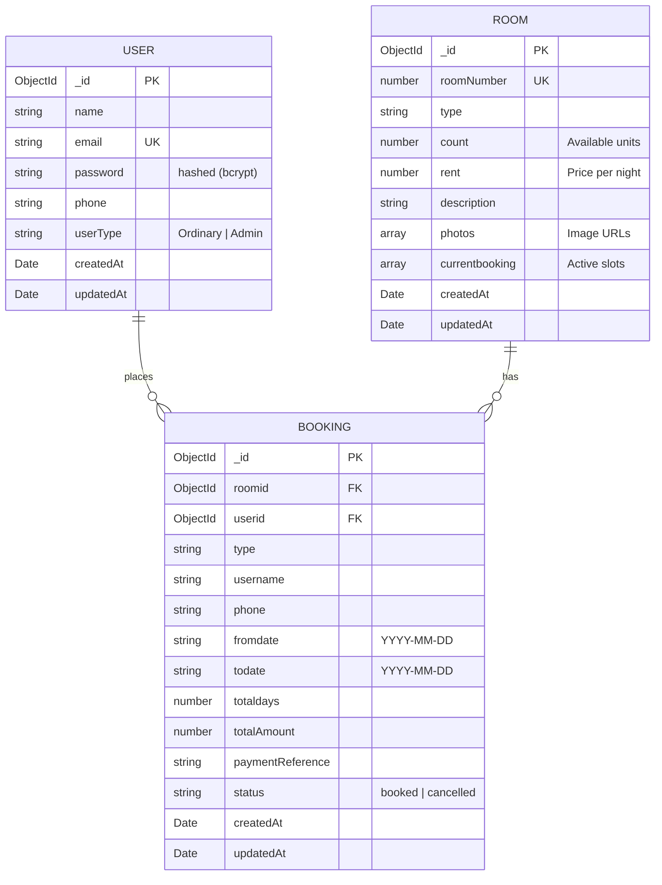

# HotelPro — Boutique Hotel Management & Reservation System

<p align="center">
  A full-stack MERN hotel booking and administrative management platform engineered for boutique stays, offering guest reservations and hotel operations oversight.
</p>

<p align="center">
  
  
  
  
  
</p>

---

## Table of Contents

- [Overview](#overview)
- [Key Features](#key-features)
  - [Guest Experience](#guest-experience)
  - [Admin Control Room](#admin-control-room)
  - [Security & Architecture](#security--architecture)
- [Tech Stack](#tech-stack)
- [Repository Structure](#repository-structure)
- [Prerequisites](#prerequisites)
- [Getting Started](#getting-started)
  - [1. Clone the Repository](#1-clone-the-repository)
  - [2. Backend Setup](#2-backend-setup)
  - [3. Frontend Setup](#3-frontend-setup)
- [Database Seeding & Demo Accounts](#database-seeding--demo-accounts)
- [Environment Configuration](#environment-configuration)
- [REST API Reference](#rest-api-reference)
- [Database Schema](#database-schema)
- [Available Scripts](#available-scripts)
- [Roadmap & Enhancements](#roadmap--enhancements)
- [License](#license)

---

## Overview

**HotelPro** is a modern, responsive web application designed for hospitality management. It bridges the gap between customer-facing booking portals and backend property management. Built with a React + Vite frontend and an Express + MongoDB backend, HotelPro delivers seamless booking flows, date overlap validation, inventory tracking, and role-based access control (RBAC).

---

## Key Features

### Guest Experience
- **Curated Room Catalog:** Browse room categories (Deluxe King, Garden Double, Signature Suite) complete with photos, amenities, pricing, and live inventory.
- **Smart Date-Range Booking:** Intuitive check-in and check-out selection with automated total night and cost calculations.
- **Conflict & Overlap Prevention:** Server-side validation prevents overbooking by tracking date overlaps against physical room inventory count.
- **Guest Dashboard:** View booking confirmations, review booking history, check reservation statuses (`booked` / `cancelled`), and cancel upcoming reservations.
- **Polished UI/UX:** Warm editorial typography, micro-interactions, responsive mobile menu, and accessible form validations.

### Admin Control Room
- **Operational Metrics:** Real-time summary statistics displaying total bookings, room inventory count, active registered guests, and non-cancelled stays.
- **Inventory Management:** Add new rooms with custom room numbers, room types, pricing per night, availability counts, descriptions, and photo links.
- **Active Booking Protection:** Room deletion is safeguarded against active bookings to protect data integrity.
- **Central Booking Oversight:** Full guest booking audit trail with guest contact details, booked dates, total payments, and reservation statuses.
- **User Directory:** List all registered users (Admins & Customers) with contact info and account creation timestamps.

### Security & Architecture
- **Stateless Authentication:** JSON Web Tokens (JWT) stored securely and transmitted via HTTP headers (`Bearer <token>`).
- **Password Hashing:** Industry-standard password hashing using `bcryptjs` with salt rounds.
- **Role-Based Access Control:** Dual-layer route guards:
  - Frontend protected route wrappers redirect unauthorized traffic.
  - Backend `authenticate` and `adminOnly` Express middleware enforce role separation on API endpoints.
- **CORS Configured:** Secure cross-origin requests between the Vite dev server (`http://localhost:5173`) and the Express API server (`http://localhost:8001`).

---

## Tech Stack

| Layer | Technology | Description |
| :--- | :--- | :--- |
| **Frontend** | [React 18](https://react.dev/) | Component-based interactive UI |
| | [Vite](https://vitejs.dev/) | Next-generation frontend build tool |
| | [React Router 6](https://reactrouter.com/) | Client-side routing and protected routes |
| | [Axios](https://axios-http.com/) | HTTP client with automatic token injection |
| | [React Icons](https://react-icons.github.io/react-icons/) | Feather icon system (`fi`) |
| | Vanilla CSS | Custom luxury aesthetic with responsive layout |
| **Backend** | [Node.js](https://nodejs.org/) & [Express 4](https://expressjs.com/) | RESTful API server |
| | [Mongoose 8](https://mongoosejs.com/) | Object Data Modeling (ODM) for MongoDB |
| | [JSON Web Token (JWT)](https://jwt.io/) | Token-based stateless authentication |
| | [bcryptjs](https://github.com/dcodeIO/bcrypt.js) | Password hashing |
| | [dotenv](https://github.com/motdotla/dotenv) | Environment configuration management |
| **Database** | [MongoDB](https://www.mongodb.com/) | Document-oriented NoSQL database |

---

## Repository Structure

```text
HotelPro/
├── client/                     # Frontend Vite + React application
│   ├── .env.example            # Client environment variable template
│   ├── index.html              # HTML entry point with Google Fonts
│   ├── package.json            # Client dependencies and scripts
│   └── src/
│       ├── App.jsx             # Core router, page components, & layouts
│       ├── api.js              # Axios instance configured with JWT interceptors
│       ├── main.jsx            # React root renderer
│       └── styles.css          # Design system, theme tokens, and responsive styles
├── server/                     # Backend Node.js + Express API
│   ├── .env.example            # Server environment variable template
│   ├── index.js                # Express app configuration & MongoDB connection
│   ├── middleware.js           # JWT authentication & adminOnly middleware
│   ├── package.json            # Server dependencies and scripts
│   ├── seed.js                 # Database seeder for demo accounts & rooms
│   ├── models/
│   │   ├── Booking.js          # Booking schema & booking status tracking
│   │   ├── Room.js             # Room inventory schema
│   │   └── User.js             # User identity & role schema (Admin / Ordinary)
│   └── routes/
│       ├── adminRoutes.js      # Admin directory & management endpoints
│       ├── authRoutes.js       # Signup, login, and user profile endpoints
│       ├── bookingRoutes.js    # Reservation creation, history, and cancellation
│       └── roomRoutes.js       # Room listing, creation, and deletion
└── README.md                   # Project documentation
```

---

## Prerequisites

Ensure you have the following installed on your development machine:

- **Node.js**: `v18.0.0` or higher ([Download Node.js](https://nodejs.org/))
- **npm**: `v9.0.0` or higher (bundled with Node.js)
- **MongoDB**: Local MongoDB community service (`mongodb://localhost:27017`) or a free [MongoDB Atlas](https://www.mongodb.com/atlas) cloud cluster

---

## Getting Started

### 1. Clone the Repository

```bash
git clone https://github.com/yash-malviya2006/HotelPro.git
cd HotelPro
```

### 2. Backend Setup

1. Open a terminal and navigate to the `server` directory:
   ```bash
   cd server
   ```

2. Install dependencies:
   ```bash
   npm install
   ```

3. Configure environment variables:
   ```bash
   cp .env.example .env
   ```
   *(On Windows Command Prompt: `copy .env.example .env`)*

   Review `.env` and verify database and port settings:
   ```env
   PORT=8001
   MONGO_URI=mongodb://localhost:27017/hotel
   JWT_SECRET=super_secret_jwt_key_change_in_production
   CLIENT_ORIGIN=http://localhost:5173
   ```

4. Populate initial data (demo users and rooms):
   ```bash
   npm run seed
   ```

5. Start the backend development server:
   ```bash
   npm run dev
   ```
   The API will be running at `http://localhost:8001`.

---

### 3. Frontend Setup

1. Open a second terminal window and navigate to the `client` directory:
   ```bash
   cd client
   ```

2. Install dependencies:
   ```bash
   npm install
   ```

3. Configure environment variables:
   ```bash
   cp .env.example .env
   ```
   *(On Windows Command Prompt: `copy .env.example .env`)*

   Verify that `VITE_API_URL` points to your backend:
   ```env
   VITE_API_URL=http://localhost:8001/api
   ```

4. Start the frontend development server:
   ```bash
   npm run dev
   ```
   Open your browser and navigate to `http://localhost:5173`.

---

## Database Seeding & Demo Accounts

The project includes an automated seed script (`server/seed.js`) that provisions initial rooms and test accounts for both user roles:

| Role | Email | Password | Access Level |
| :--- | :--- | :--- | :--- |
| **Admin** | `admin@hotelpro.in` | `admin@123` | Full access to Admin Control Room, room management, all bookings, and user directory |
| **Customer** | `testuser@gmail.com` | `testuser@123` | Room reservations, booking dashboard, reservation cancellations |

To re-run the seed script at any time:
```bash
cd server
npm run seed
```

---

## Environment Configuration

### Server (`server/.env`)
| Variable | Default Value | Description |
| :--- | :--- | :--- |
| `PORT` | `8001` | Port number the Express API server listens on |
| `MONGO_URI` | `mongodb://localhost:27017/hotel` | MongoDB connection string (Local or MongoDB Atlas) |
| `JWT_SECRET` | `replace_this_with_a_long_random_secret` | Secret key used for signing and verifying JSON Web Tokens |
| `CLIENT_ORIGIN`| `http://localhost:5173` | Allowed frontend origin for Cross-Origin Resource Sharing (CORS) |

### Client (`client/.env`)
| Variable | Default Value | Description |
| :--- | :--- | :--- |
| `VITE_API_URL` | `http://localhost:8001/api` | Base URL for backend API requests |

---

## REST API Reference

### Health Check
- `GET /api/health` — Service health and readiness verification.

### Authentication (`/api/auth`)
| Method | Endpoint | Access | Description |
| :--- | :--- | :--- | :--- |
| `POST` | `/api/auth/signup` | Public | Register a new user (`name`, `email`, `password`, `phone`, `userType`) |
| `POST` | `/api/auth/login` | Public | Authenticate credentials and receive a JWT token |
| `GET` | `/api/auth/me` | Authenticated | Retrieve authenticated user profile |

### Rooms (`/api/rooms`)
| Method | Endpoint | Access | Description |
| :--- | :--- | :--- | :--- |
| `GET` | `/api/rooms` | Public | List all active rooms ordered by room number |
| `POST` | `/api/rooms` | Admin Only | Create a new room with inventory count & pricing |
| `DELETE`| `/api/rooms/:id` | Admin Only | Delete a room (blocked if active reservations exist) |

### Bookings (`/api/bookings`)
| Method | Endpoint | Access | Description |
| :--- | :--- | :--- | :--- |
| `POST` | `/api/bookings` | Authenticated | Reserve a room (`roomId`, `fromdate`, `todate`) with overlap check |
| `GET` | `/api/bookings/mine` | Authenticated | Retrieve reservations placed by the authenticated guest |
| `PATCH`| `/api/bookings/:id/cancel`| Authenticated | Cancel a reservation and release room availability |
| `GET` | `/api/bookings` | Admin Only | View all reservations across all guests |

### Admin (`/api/admin`)
| Method | Endpoint | Access | Description |
| :--- | :--- | :--- | :--- |
| `GET` | `/api/admin/users` | Admin Only | Retrieve a list of all registered accounts |

---

## Database Schema



---

## Available Scripts

### Client (`/client`)
- `npm run dev` — Starts the local Vite development server with Hot Module Replacement (HMR).
- `npm run build` — Compiles production-ready bundle into `/dist`.
- `npm run preview` — Locally preview the production build output.

### Server (`/server`)
- `npm run dev` — Runs the server with `nodemon` for auto-reloading on changes.
- `npm start` — Runs the server in standard production mode with `node index.js`.
- `npm run seed` — Populates database with default rooms and demo accounts.

---

## Roadmap & Enhancements

- [ ] **Payment Gateway Integration:** Connect Stripe or Razorpay webhooks for live payment processing.
- [ ] **Cloud Storage Uploads:** Support direct image file uploads using AWS S3 or Cloudinary.
- [ ] **Email & SMS Notifications:** Automated reservation receipts and booking cancellation confirmations.
- [ ] **Room Amenity Filtering:** Filter rooms by amenities (Wi-Fi, Balcony, Sea view, Breakfast included).
- [ ] **Date Picker Enhancement:** Interactive calendar view highlighting unavailable dates directly in the room view.

---

## License

This project is licensed under the [ISC License](LICENSE).
